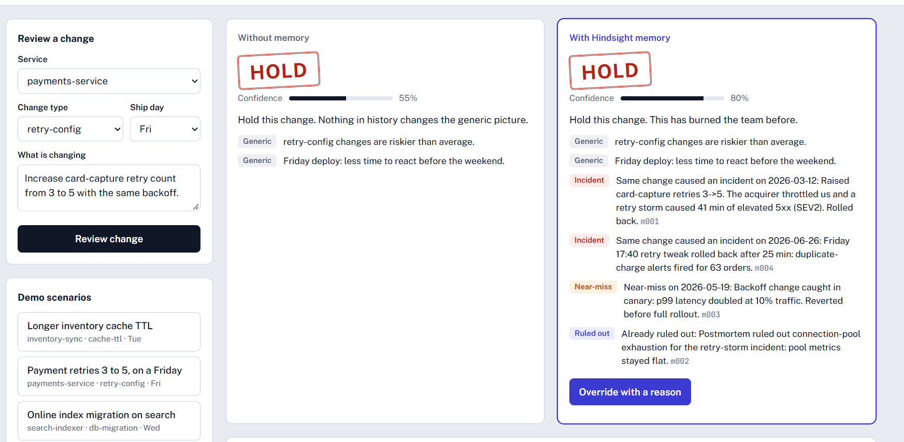
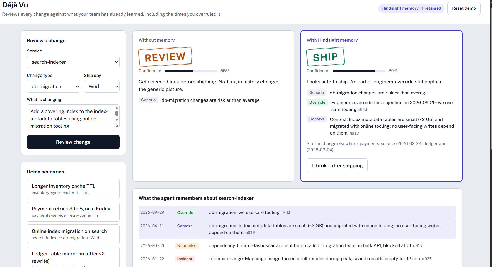
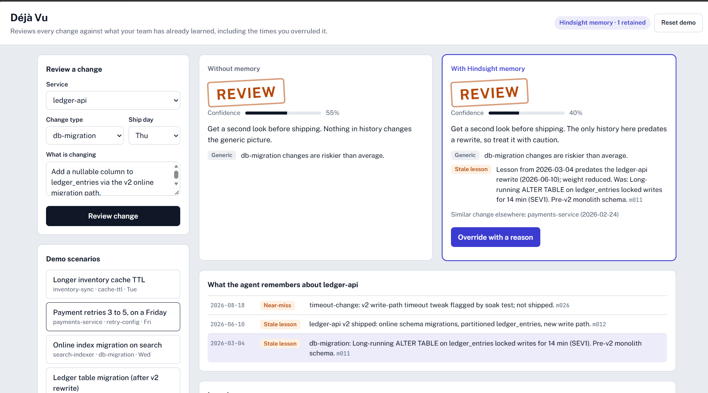
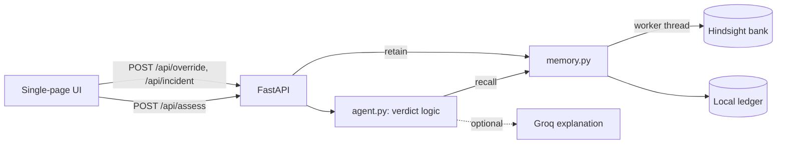

# Déjà Vu

**A change-risk agent that remembers what broke, what was ruled out, and when engineers overruled it.**

Déjà Vu reviews a deploy or config change and returns **SHIP**, **REVIEW** or **HOLD**. It decides using your team's own history, retained in [Hindsight](https://github.com/vectorize-io/hindsight) agent memory, and it gets better every time an engineer overrules it and says why.



## Why this exists

Teams ship the same bad change twice. The lesson from the first outage lives in a postmortem nobody reopens or in one engineer's head. A stateless reviewer can only say "retry changes are riskier than average." That is true of every team and useful to none.

Déjà Vu treats team history as the product: incidents, near-misses, causes that were already ruled out, and the reasons engineers gave when they said "this one is fine."

## What makes it different

| Capability | What it does |
|---|---|
| **Learns from being overruled** | An engineer's override and its written reason are retained and reused on the next review of a similar change. |
| **Negative knowledge** | Near-misses and ruled-out causes are first-class memories, so the agent stops sending people down dead ends. |
| **Memory that expires** | Lessons dated before a service rewrite are flagged **stale**, down-weighted, and lower the verdict's confidence instead of blocking forever. |
| **Supersession** | A newer incident overrides an older engineer override for the same service and change type. |

## Demo results

Observed on a freshly seeded bank with Hindsight-only recall (`DEJAVU_STRICT=1`):

| Scenario | Without memory | With Hindsight memory |
|---|---|---|
| Payment retries 3 to 5, on a Friday | HOLD, 55%, generic reasons only | HOLD, 80%, cites two incidents, a near-miss and a ruled-out cause |
| Online index migration on search | REVIEW, 55% | REVIEW, then **SHIP, 80%** after an engineer override with a reason |
| Ledger table migration after the v2 rewrite | REVIEW, 55% | Old incident flagged **stale**, then **SHIP, 65%** after an override |




## How Hindsight is used

Hindsight is the only source of team knowledge in strict mode. The integration lives in `app/memory.py`.

| Hindsight operation | Where and why |
|---|---|
| `create_bank` | Creates the bank with a mission that tells Hindsight to emphasize overrides, near-misses and stale lessons. |
| `retain` (batch) | Seeds historical records. Each is tagged `service:`, `pattern:` and `kind:`, and its `document_id` is the memory id (for example `m011`). |
| `retain` | Live overrides and incidents are retained when an engineer saves them in the UI. |
| `recall` | Every review recalls memories scoped by service and pattern tags. Results are mapped back to memory ids through `document_id` and cited in the verdict. |
| `reflect` | Optional. Enabled with `DEJAVU_REFLECT=1` and called on each review. |

Hindsight processes retained memories asynchronously. After saving an override, allow roughly 30 seconds before reviewing again. All Hindsight calls go through a single worker thread with one retry, because the synchronous client cannot be shared across threads.

### Strict mode

By default, the app unions Hindsight recall with a local structured ledger (`data/ledger.json`) so it stays usable if the network hiccups. That means a correct verdict alone does not prove Hindsight recall. To prove it, run with:

```
DEJAVU_STRICT=1
```

In strict mode the verdict is built from Hindsight recall only. The results above were produced this way.

## Verdict logic

The verdict is deterministic and explainable (`app/agent.py`). A language model is optional and only writes a two-sentence explanation.

- **Generic score** starts from a pattern risk prior, plus 0.15 on Fridays.
- **Fresh incident** adds 0.5 (0.2 more if there is more than one). **Fresh near-miss** adds 0.2.
- **Stale lessons** (dated before a service rewrite) add no score and lower confidence.
- **A valid override** caps the score at 0.20, unless a newer incident supersedes it. Ordering uses `(date, memory sequence id)` so same-day events resolve correctly.
- **Thresholds:** HOLD at 0.60 or above, REVIEW at 0.40 or above, SHIP below 0.40.

## Architecture



### Project layout

```
app/
  data.py     Synthetic seed history (32 records), services, rewrite dates, demo scenarios, benchmark stream
  memory.py   Ledger and Hindsight memory (retain / recall / reflect)
  agent.py    Deterministic verdict logic, optional Groq summary
  bench.py    Replays 46 changes through a stateless and a memory agent
  main.py     FastAPI endpoints
  seed.py     Resets the ledger and bulk-loads the seed into Hindsight
static/
  index.html  UI: side-by-side verdicts, override flow, memory timeline, learning curve
final_setup.ps1  One-command clean setup for recording or presenting (Windows)
```

### API

| Endpoint | Purpose |
|---|---|
| `GET /api/meta` | Services, change types and demo scenarios |
| `GET /api/status` | Backend, active bank, retained count, last error |
| `POST /api/assess` | Review a change and return both verdicts |
| `POST /api/override` | Retain an engineer override with a reason |
| `POST /api/incident` | Retain a new incident |
| `GET /api/memories?service=...` | Memories the agent holds for a service |
| `GET /api/benchmark`, `POST /api/benchmark/run` | Read or re-run the learning-curve benchmark |
| `POST /api/reset` | Fresh bank and reseed (slow, avoid during a live demo) |

## Quick start

**Requirements:** Python 3.10+ and a Hindsight Cloud account (API URL and key from the dashboard).

```powershell
# Windows PowerShell
python -m venv .venv
.venv\Scripts\activate
pip install -r requirements.txt

$env:HINDSIGHT_URL = "<your Hindsight API base URL>"
$env:HINDSIGHT_API_KEY = "<your key>"
```

```bash
# macOS / Linux
python -m venv .venv && source .venv/bin/activate
pip install -r requirements.txt

export HINDSIGHT_URL="<your Hindsight API base URL>"
export HINDSIGHT_API_KEY="<your key>"
```

**Seed a bank.** Run `python -m app.seed`. It prints the bank it created, for example `Seeded 32 memories into bank dejavu-demo-r... errors: 0`. Set that name as `HINDSIGHT_BANK`, wait about 90 seconds for Hindsight to finish processing, then start the app:

```powershell
$env:HINDSIGHT_BANK = "<bank name printed by the seed>"
$env:DEJAVU_STRICT = "1"
uvicorn app.main:app
```

Open http://localhost:8000. The header badge should read **Hindsight memory, 0 retained**.

**Windows shortcut.** `final_setup.ps1` does all of the above (clean ledger, seed, read the bank name, wait, start in strict mode):

```powershell
.\final_setup.ps1            # strict mode
.\final_setup.ps1 -NoStrict  # union with local ledger
```

**Local-only mode.** Run `uvicorn app.main:app` without `HINDSIGHT_URL` to use the local ledger only. Useful for development, but it does not exercise Hindsight.

### Configuration

| Variable | Purpose |
|---|---|
| `HINDSIGHT_URL` | Hindsight API base URL |
| `HINDSIGHT_API_KEY` | Hindsight API key |
| `HINDSIGHT_BANK` | Bank the app reads. It must match the bank you seeded. |
| `DEJAVU_STRICT` | `1` uses Hindsight recall only |
| `DEJAVU_REFLECT` | `1` calls Hindsight reflect on every review |
| `GROQ_API_KEY` | Optional. Enables the two-sentence explanation. A template is used without it. |

## Try it

1. Open **Payment retries 3 to 5, on a Friday** and review. Compare the two cards.
2. Open **Online index migration on search**, review, then **Override with a reason**. Save once, wait about 30 seconds, review again.
3. Open **Ledger table migration (after v2 rewrite)** and look for the **Stale lesson** badge.

## Known limitations

- **The seed history is synthetic.** The 32 seed records and the 46-change benchmark stream are realistic but invented. Real postmortems would be the natural next data source.
- **The learning curve is a simulation.** It replays 46 changes with a scripted oracle supplying overrides and incidents (26 wrong verdicts without memory vs 9 with it). It demonstrates the mechanism, not real-world accuracy. It runs on the local ledger for determinism.
- **Retention is asynchronous.** In strict mode, recall immediately after saving an override can lag.
- **The seed rotates banks.** `python -m app.seed` creates a timestamped bank. Use the printed name, or use `final_setup.ps1`, which reads it for you.
- **Reset demo is slow.** It creates a fresh bank and reseeds synchronously, so avoid it during a live presentation.

## Roadmap

- A GitHub Action that reviews real pull requests and comments the verdict
- Ingesting real postmortems as memory
- Per-team memory banks

## Links

- Hindsight: https://github.com/vectorize-io/hindsight
- Hindsight docs: https://hindsight.vectorize.io/
- Agent memory overview: https://vectorize.io/what-is-agent-memory
- Demo video: https://youtu.be/mjjKT-AeKmA